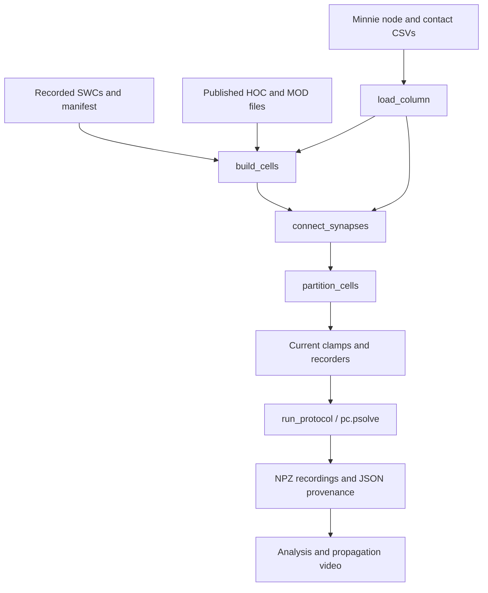

# How the Minnie simulation works

For the shortest route to the computation, use the [critical simulation code path](CRITICAL_SIMULATION_PATH.md), with direct links to SWC import, channels, synapses, stimulus and the native solver call.

Choose a [dataset entry file](DATASET_ENTRY_POINTS.md) first. `neuronsim/datasets.py` holds identities, URLs and preflight checks. Original three-cell/L23 coordinate contacts share `neuronsim/archive.py`; prepared column/full-Minnie inputs use the engine below. Both reuse the SWC importer, published model, receptor factory, solver configuration and native partitioner. [Validation status](VALIDATION.md) distinguishes current checks from historical benchmarks.

Start in [`simulation.run()`](../neuronsim/simulation.py). It lists construction and execution steps in order. [`cli.py`](../neuronsim/cli.py) parses options; the older [`tools/run_minnie_241165.py`](../tools/run_minnie_241165.py) is a compatible launcher.

We wrote the Python data mapping, cell construction, connections, experiments, threading, recording, and rendering. ModelDB supplies the ion-channel equations and regional parameters. NEURON supplies the native cable solver.



## 1. Find the settings

Open [`config.py`](../neuronsim/config.py). `ModelParameters` groups simulation and synapse assumptions with their units:

| Setting | Value | Meaning |
| --- | ---: | --- |
| `dt_ms` | 0.025 ms | Fixed integration step |
| `temperature_c` | 34°C | Published simulation temperature |
| `contact_conductance_us` | 0.01 µS | 10 nS per contact |
| `synapse_rise_ms` / `synapse_decay_ms` | 0.5 / 3 ms | `Exp2Syn` waveform |
| `delay_ms` | 1 ms | Assumed delivery delay |
| `record_stride` | 4 | Export every fourth native step: 0.1 ms |

Intrinsic densities are not duplicated here. `PROFILE` points to the unchanged [`biophysics.hoc`](../vendor/aberra2018/cells/L4_LBC_cACint209_1/biophysics.hoc). That file assigns sodium/calcium densities, leak, and distance-dependent `Ih` by region. For sodium-channel state equations, inspect [`NaTs2_t.mod`](../vendor/aberra2018/mechanisms/NaTs2_t.mod).

`make_protocols()` defines prepared-network injections and controls. The historical column/full-Minnie protocols used 0.5 nA into 32 neurons from 10–60 ms. A paired control preserves the stimulus and sets transmission weights to zero. Current named archive entries use 1 nA at 0–1 ms. All four named entries use direct somatic `IClamp` injection; none inserts/drives `xtra` to apply an extracellular electric field.

## 2. Load observed identities and connections

Read [`data.load_column()`](../neuronsim/data.py). Prepared inputs are:

- `nodes.csv`: exact root/nucleus IDs, manual class, E/I label, and soma coordinates in micrometers.
- `edges.csv`: presynaptic ID, postsynaptic ID, `n_syn` contact count, and source metadata.
- `manifest.json` and `swc/{root_id}.swc`: identity links, checksums, repair provenance, and trees.

IDs remain strings: 18-digit neuron IDs must not pass through floating-point conversion. `checked_swc()` verifies nucleus identity and file hash. [`graph.py`](../neuronsim/graph.py) counts contacts and connected components.

Column preparation uses [`prepare_minnie.py`](../tools/prepare_minnie.py) for v943 annotations/wiring and [`prepare_minnie_skeletons.py`](../tools/prepare_minnie_skeletons.py) for v661 SWCs linked by nucleus ID. Full-Minnie preparation instead uses [`prepare_nas_network.py`](../tools/prepare_nas_network.py) on v1300 inputs. Their distinct policies and source URLs are in [dataset entry points](DATASET_ENTRY_POINTS.md).

## 3. Build each recorded neuron

Read [`network.build_cells()`](../neuronsim/network.py), then [`PublishedSWCCell`](../neuronsim/cell.py).

Our `load_swc()` validates the file first; NEURON's `h.Import3d_SWC_read()` and `Import3d_GUI.instantiate()` then create cable sections from its recorded soma/branches. `nseg` divides sections into computational compartments. The `profile.biophys(self)` call applies the published HOC mechanisms and regional densities.

Lengths, diameters, and branching participate in the cable equations. Missing axons stay missing. The current adaptation applies the **same L4 basket-cell electrical profile to every tree**; Minnie labels do not supply individually fitted conductances.

[`optimizations.py`](../neuronsim/optimizations.py) removes only `Nap_Et2`/`K_Tst` instances whose section conductances are entirely zero. This assumes those channels will not later be enabled or have their removed states recorded.

## 4. Create synapses

Return to [`network.connect_synapses()`](../neuronsim/network.py). A pair with `n_syn=3` creates three `h.Exp2Syn` objects through `create_synapse()` and three `pc.gid_connect(...)` connections. The total equals the selected dataset's contacts: 124,341 for the column or 13,309,933 for the full eligible Minnie cohort.

The essential operations are:

```python
synapse = create_synapse(h, postsynaptic_segment, reversal)
connection = pc.gid_connect(presynaptic_gid, synapse)
connection.delay = PARAMETERS.delay_ms
connection.weight[0] = PARAMETERS.contact_conductance_us
```

`synaptic_reversal()` uses the **presynaptic** Minnie label: 0 mV for E and, with `--inhibition`, −80 mV for I. Weights remain positive. Current depends on `g(t) * (V - E_reversal)`; reversal potential supplies inhibitory polarity.

Identities and contact counts are observed. Precise coordinates are unavailable in the aggregate table, so target sections are sampled by membrane area and positions within sections use a fixed seed. `modeled_sites.csv.gz` exports the choices. Named column/full-Minnie entries enable E/I by default; `--no-inhibition` explicitly selects all-excitatory outputs. The generic `python -m neuronsim` CLI preserves its older all-excitatory default and requires `--inhibition` for E/I.

## 5. Divide work across native threads

Read [`network.partition_cells()`](../neuronsim/network.py). It sorts cells by compartment count and assigns each to the lightest worker. One cell's entire cable tree stays on one thread.

`pc.nthread(thread_count)` enables native NEURON workers; `pc.partition()` assigns trees within that process/MPI rank. A HOC helper preserves numeric thread IDs that NEURON 9's Python binding otherwise coerces to booleans. `ThreadPartition.verify()` checks actual section ownership. The historical full-Minnie run used 96 MPI ranks with one native thread per rank; see [MPI construction](MPI_CONSTRUCTION.md).

## 6. Inject current and solve

Read [`simulation.run_protocol()`](../neuronsim/simulation.py):

1. Set soma `IClamp` amplitudes and timing.
2. Set transmission conductances, including controls.
3. Clear spike buffers and initialize at −65 mV.
4. Call `pc.psolve()` in 10 ms progress chunks.
5. Check finite voltages and final time, then save results.

The Python loop's 10 ms chunks are not integration steps. NEURON executes every **0.025 ms step in compiled code** inside `pc.psolve()`. One model second takes 40,000 steps; Python does not loop over every neuron/synapse on each step.

The native solver and compiled MOD equations account for much of the speed. Cache-efficient layout, whole-cell balancing, inactive-channel removal, and selective recording also help. Construction, initialization, solving, and export are separate costs.

## 7. Record and render computed activity

Read [`recording.py`](../neuronsim/recording.py). `PopulationRecording` records soma voltage every native step with an explicit owner, downsamples by four, and captures GID spikes. Zero-amplitude recording anchors establish thread ownership; they are separate from the real stimulus clamps and inject no current.

`BranchRecording` records every segment on selected trees and exports each segment's 3D polyline, including imported bends. In the historical column video, three trees were recorded while all 1,352 cells and 525,498 compartments were integrated. MPI branch recording is unsupported. The full-Minnie run saved soma voltages/spikes only; its population video does not depict voltage traveling along branches.

| Output | Content |
| --- | --- |
| `cell_models.csv` | Identity, profile, E/I class, and selected stimulus IDs |
| `modeled_sites.csv.gz` | Contact section/position, strength, reversal, and delay |
| `branch_geometry.json` | Selected cable segments and 3D centerlines |
| `long_protocol/recordings.npz` | Times, root IDs, soma voltages, spike times and IDs |
| `long_protocol/branch_recordings.npz` | Float32 segment-voltage visualization copies |
| `long_protocol/summary.json` | Parameters, source/input hashes, counts, timings, and assumptions |

[`tools/render_minnie_video.py`](../tools/render_minnie_video.py) reads saved column soma/branch arrays, maps voltage to color, and writes the MP4 through FFmpeg. [`render_population_video.py`](../tools/render_population_video.py) renders soma activity from the full-Minnie or other compatible population recordings. Neither runs the model. [`validate_minnie_video.py`](../tools/validate_minnie_video.py) checks the historical column benchmark and branch/soma alignment.

## Shortest reading route

`simulation.run()` → `network.build_cells()` → `PublishedSWCCell` → `connect_synapses()` → `partition_cells()` → `run_protocol()` → `recording.py` → the renderer.

Use [the README](../README.md) for commands and [the documentation index](README.md) for current versus historical experiments. Earlier launchers and saved artifact paths remain available.

## Historical cleanup verification

Before the stimsim import, a NeuronSim reorganization passed 26 tests. Its 96-native-thread, full-column 100 ms run reproduced the saved benchmark's 781 spikes, every soma-voltage sample, and every recorded sample on the 2,085 selected branch segments exactly. Maximum soma-voltage difference was 0 mV. See [external numerical validation and branch-comparison locations](ARTIFACT_LOCATIONS.md#column-regression). These are historical results; [current-checkout validation](VALIDATION.md) does not claim a new full-column rerun.

The reorganization preserved its original downloaded scripts, upstream HOC/MOD files, `AGENTS.md`, and saved recordings/videos. Stimsim's separate `neuron-python-share/` originals are also retained unchanged.
