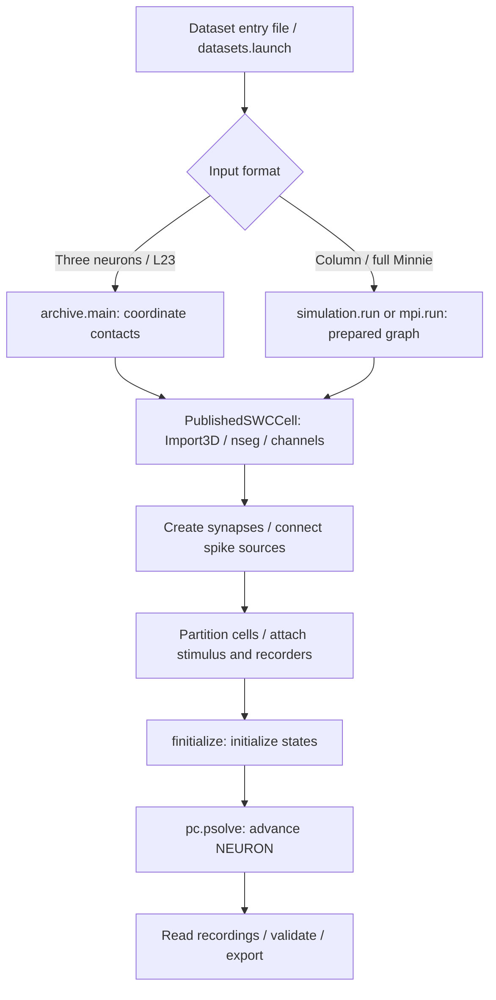

# Critical simulation code path

**The call that advances the simulation is `pc.psolve(stop)`.** For column/full-Minnie runs, open [`simulation.py` at that call](../neuronsim/simulation.py#L125). For three-neuron/L23 runs, open [`archive.py`](../neuronsim/archive.py#L232). NEURON executes the cable equations, compiled channel mechanisms and queued synaptic events inside that call. Python's 5/10 ms progress chunks contain many fixed 0.025 ms integration steps.

Search `SIMULATION CORE` to find the highlighted blocks:

```sh
rg -n 'SIMULATION CORE' neuronsim
```

## Execution routes



## Read these blocks in order

| Step | Code | Why it matters |
| --- | --- | --- |
| Numerical and physical settings | [`config.py`](../neuronsim/config.py#L13), [`configure_solver()`](../neuronsim/simulation.py#L29) | Timestep, temperature, initial voltage, synaptic constants and fixed-step solver selection |
| SWC → connected cable sections | [`PublishedSWCCell`](../neuronsim/cell.py#L29) | `Import3d_SWC_read` / `instantiate` create the native morphology |
| Electrical compartments and channels | [`cell.py`](../neuronsim/cell.py#L49) | `section.nseg` selects compartment resolution; `profile.biophys(self)` inserts channels and assigns their densities |
| Actual published biophysics | [`biophysics.hoc`](../vendor/aberra2018/cells/L4_LBC_cACint209_1/biophysics.hoc#L48), e.g. [`NaTs2_t.mod`](../vendor/aberra2018/mechanisms/NaTs2_t.mod#L40) | HOC sets regional parameters; compiled MOD files define channel currents and state evolution. Upstream files remain unchanged. |
| Synaptic currents and spike delivery | [`create_synapse()` / `connect_synapses()`](../neuronsim/network.py#L112); archive connections in [`archive.py`](../neuronsim/archive.py#L193) | Receptor kinetics, reversal potential, attachment site, spike threshold, weight and delay determine communication |
| Stimulus, initialization, integration | [`run_protocol()`](../neuronsim/simulation.py#L94); archive stimulus/solve in [`archive.py`](../neuronsim/archive.py#L215) | `IClamp` supplies current, `finitialize` resets states, `psolve` advances them |
| Parallel ownership and routing | [`partition_cells()`](../neuronsim/network.py#L190), [`mpi.run()`](../neuronsim/mpi.py#L53) | Whole neurons belong to native workers/ranks; GIDs route spike events between ranks. MPI reuses `run_protocol()`. |

**Connection-method distinction:** the original three-neuron/L23 experiments use coordinate-mapped presynaptic and postsynaptic segments. Column/full-Minnie runs detect somatic spikes and sample dendritic targets by area. These choices can change which cells fire; they are not interchangeable performance settings.

## Supporting paths

Dataset selection, checksums and SWC validation ensure the intended inputs reach construction. Preparation can change those inputs through the documented repairs. They do not advance membrane voltage. [`recording.py`](../neuronsim/recording.py) attaches native observers before initialization, then reads/exports their values; recording scope affects memory and performance. The renderers read saved arrays after simulation.

For one compact orchestration function, start at [`simulation.run()`](../neuronsim/simulation.py#L164), then follow its calls above. The [longer walkthrough](CODE_WALKTHROUGH.md) explains each stage; [dataset entry points](DATASET_ENTRY_POINTS.md) identify the exact inputs and source URLs.
