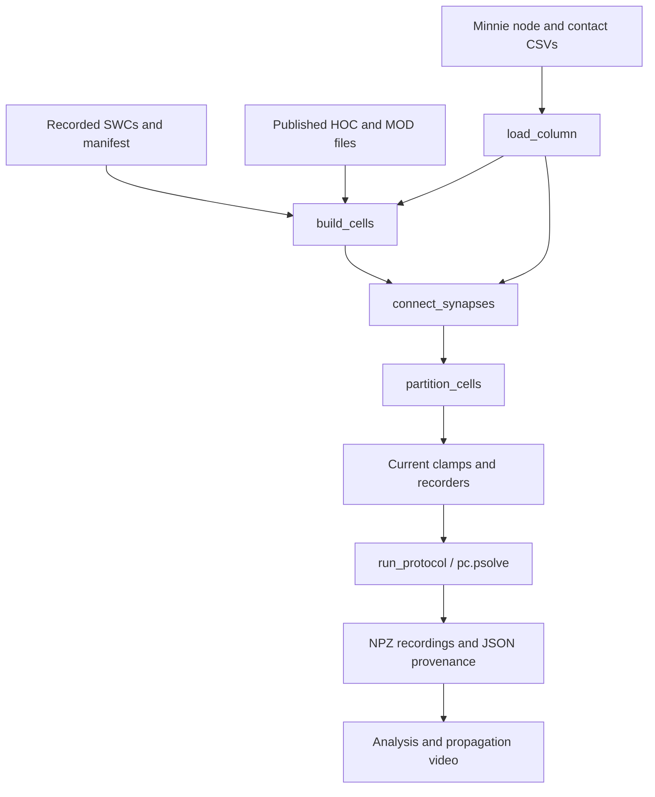

# How the Minnie simulation works

Start in [`simulation.run()`](../neuronsim/simulation.py). It lists construction and execution steps in order. [`cli.py`](../neuronsim/cli.py) parses options; the older [`tools/run_minnie_241165.py`](../tools/run_minnie_241165.py) is a compatible launcher.

We wrote the Python data mapping, cell construction, connections, experiments, threading, recording, and rendering. ModelDB supplies the ion-channel equations and regional parameters. NEURON supplies the native cable solver.



## 1. Find the settings

Open [`config.py`](../neuronsim/config.py). `ModelParameters` groups simulation and synapse assumptions with their units:

| Setting | Value | Meaning |
| --- | ---: | --- |
| `dt_ms` | 0.025 ms | Fixed integration step |
| `temperature_c` | 34°C | Published simulation temperature |
| `contact_conductance_us` | 0.01 µS | 10 nS per contact |
| `synapse_rise_ms` / `synapse_decay_ms` | 0.5 / 3 ms | `Exp2Syn` waveform |
| `delay_ms` | 1 ms | Assumed delivery delay |
| `record_stride` | 4 | Export every fourth native step: 0.1 ms |

Intrinsic densities are not duplicated here. `PROFILE` points to the unchanged [`biophysics.hoc`](../vendor/aberra2018/cells/L4_LBC_cACint209_1/biophysics.hoc). That file assigns sodium/calcium densities, leak, and distance-dependent `Ih` by region. For sodium-channel state equations, inspect [`NaTs2_t.mod`](../vendor/aberra2018/mechanisms/NaTs2_t.mod).

`make_protocols()` defines injections and controls. The video uses 0.5 nA into 32 neurons from 10–60 ms. A paired control preserves the stimulus and sets transmission weights to zero.

## 2. Load observed identities and connections

Read [`data.load_column()`](../neuronsim/data.py). Prepared inputs are:

- `nodes.csv`: exact root/nucleus IDs, manual class, E/I label, and soma coordinates in micrometers.
- `edges.csv`: presynaptic ID, postsynaptic ID, `n_syn` contact count, and source metadata.
- `manifest.json` and `swc/{root_id}.swc`: identity links, checksums, repair provenance, and trees.

IDs remain strings: 18-digit neuron IDs must not pass through floating-point conversion. `checked_swc()` verifies nucleus identity and file hash. [`graph.py`](../neuronsim/graph.py) counts contacts and connected components.

Preparation happens in [`prepare_minnie.py`](../tools/prepare_minnie.py) for v943 annotations/wiring and [`prepare_minnie_skeletons.py`](../tools/prepare_minnie_skeletons.py) for v661 SWCs linked by nucleus ID. Their validation/repair policies are in [the geometry report](../MINNIE_COLUMN.md).

## 3. Build each recorded neuron

Read [`network.build_cells()`](../neuronsim/network.py), then [`PublishedSWCCell`](../neuronsim/cell.py).

`h.Import3d_SWC_read()` imports the soma, axon, basal dendrites, and apical dendrites as connected cable sections. `nseg` divides sections into computational compartments. The `profile.biophys(self)` call applies the published HOC mechanisms and regional densities.

Lengths, diameters, and branching participate in the cable equations. Missing axons stay missing. The current adaptation applies the **same L4 basket-cell electrical profile to every tree**; Minnie labels do not supply individually fitted conductances.

[`optimizations.py`](../neuronsim/optimizations.py) removes only `Nap_Et2`/`K_Tst` instances whose section conductances are entirely zero. This assumes those channels will not later be enabled or have their removed states recorded.

## 4. Create synapses

Return to [`network.connect_synapses()`](../neuronsim/network.py). A pair with `n_syn=3` creates three `h.Exp2Syn` objects and three `pc.gid_connect(...)` connections. The full-column object count must equal 124,341.

The essential operations are:

```python
synapse = h.Exp2Syn(postsynaptic_segment)
synapse.tau1 = 0.5
synapse.tau2 = 3.0
synapse.e = reversal
connection = pc.gid_connect(presynaptic_gid, synapse)
connection.delay = 1.0
connection.weight[0] = 0.01
```

`synaptic_reversal()` uses the **presynaptic** Minnie label: 0 mV for E and, with `--inhibition`, −80 mV for I. Weights remain positive. Current depends on `g(t) * (V - E_reversal)`; reversal potential supplies inhibitory polarity.

Identities and contact counts are observed. Precise coordinates are unavailable in the aggregate table, so target sections are sampled by membrane area and positions within sections use a fixed seed. `modeled_sites.csv.gz` exports the choices. `--inhibition` is explicit so the earlier all-excitatory configuration remains reproducible.

## 5. Divide work across native threads

Read [`network.partition_cells()`](../neuronsim/network.py). It sorts cells by compartment count and assigns each to the lightest worker. One cell's entire cable tree stays on one thread.

`pc.nthread(96)` enables native NEURON workers; `pc.partition()` assigns trees. This is one process/MPI rank. A HOC helper preserves numeric thread IDs that NEURON 9's Python binding otherwise coerces to booleans. `ThreadPartition.verify()` checks actual section ownership.

## 6. Inject current and solve

Read [`simulation.run_protocol()`](../neuronsim/simulation.py):

1. Set soma `IClamp` amplitudes and timing.
2. Set transmission conductances, including controls.
3. Clear spike buffers and initialize at −65 mV.
4. Call `pc.psolve()` in 10 ms progress chunks.
5. Check finite voltages and final time, then save results.

The Python loop's 10 ms chunks are not integration steps. NEURON executes every **0.025 ms step in compiled code** inside `pc.psolve()`. One model second takes 40,000 steps; Python does not loop over every neuron/synapse on each step.

The native solver and compiled MOD equations account for much of the speed. Cache-efficient layout, whole-cell balancing, inactive-channel removal, and selective recording also help. Construction, initialization, solving, and export are separate costs.

## 7. Record and render computed activity

Read [`recording.py`](../neuronsim/recording.py). `PopulationRecording` records soma voltage every native step with an explicit owner, downsamples by four, and captures GID spikes. Zero-amplitude recording anchors establish thread ownership; they are separate from the real stimulus clamps and inject no current.

`BranchRecording` records every segment on selected trees and exports each segment's 3D polyline, including imported bends. Each video line receives its own recorded voltage rather than its soma voltage. Recording three detailed trees does not reduce the simulated network: all 1,352 cells and 525,498 compartments are still integrated.

| Output | Content |
| --- | --- |
| `cell_models.csv` | Identity, profile, E/I class, and selected stimulus IDs |
| `modeled_sites.csv.gz` | Contact section/position, strength, reversal, and delay |
| `branch_geometry.json` | Selected cable segments and 3D centerlines |
| `long_protocol/recordings.npz` | Times, root IDs, soma voltages, spike times and IDs |
| `long_protocol/branch_recordings.npz` | Float32 segment-voltage visualization copies |
| `long_protocol/summary.json` | Parameters, source/input hashes, counts, timings, and assumptions |

[`tools/render_minnie_video.py`](../tools/render_minnie_video.py) reads these arrays, maps voltage to color, and writes the MP4 through FFmpeg. It does not run the model. [`validate_minnie_video.py`](../tools/validate_minnie_video.py) checks the earlier benchmark and branch/soma alignment.

## Shortest reading route

`simulation.run()` → `network.build_cells()` → `PublishedSWCCell` → `connect_synapses()` → `partition_cells()` → `run_protocol()` → `recording.py` → the renderer.

Use [the README](../README.md) for commands and [the documentation index](README.md) for current versus historical experiments. Earlier launchers and saved artifact paths remain available.

## Cleanup verification

The reorganization passes 26 tests. A new 96-thread, full-column 100 ms run reproduces the saved benchmark's 781 spikes, every soma-voltage sample, and every recorded sample on the 2,085 selected branch segments exactly. Maximum soma-voltage difference is 0 mV. See [the numerical validation](../outputs/NeuronSim-minnie-column.WCVsAeuu/outputs/cleanup_full100/validation.json) and [branch comparison](../outputs/NeuronSim-minnie-column.WCVsAeuu/outputs/cleanup_full100/refactor_regression.json).

The original downloaded scripts, upstream HOC/MOD files, `AGENTS.md`, and existing saved recordings/videos were preserved.
